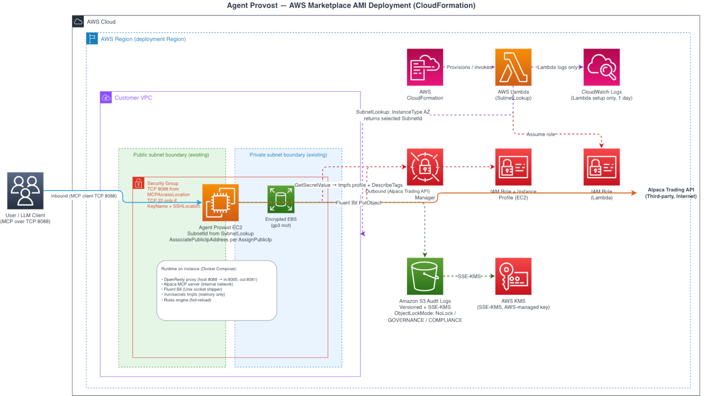

# LLM Provost

Governance proxy and audit ledger for MCP-mediated LLM interactions.

<p align="center">
  
</p>

LLM Provost is a mandatory policy and observability boundary that sits in front of MCP servers and upstream model/tool APIs.
It is designed for secure, sovereign operation: you run it in your own environment, control the policy file, and own the audit logs.

## What It Does

LLM Provost provides all of the following in one control point:

[](https://www.youtube.com/watch?v=BEWJ4VHBHFk)


**👉 Launch on AWS Marketplace:** [LLM Provost AMI](https://aws.amazon.com/marketplace/pp/prodview-ouyql6wbwo6yg) soon!


## Four-Point Audit Trail

For normal governed traffic, LLM Provost captures and correlates these four events:

1. LLM client request enters the llm-to-mcp boundary
2. MCP server request exits through the mcp-to-upstream boundary
3. Upstream response returns to MCP through the same boundary
4. MCP response returns to the LLM client through the inbound boundary

Correlation fields used across hops:

- provost_user
- provost_machine
- provost_request_id

## Core Controls

The current implementation and policy model include:

1. Programmable governance guardrails (allow/block tool calls)
2. Per-tool rate limiting
3. Token caps for tool requests
4. Time-based access controls
5. Identity-rich audit logging
6. LLM chat governance on non-MCP paths (`llm_rules`: PII filtering + token caps)
7. Per-MCP-server policy dispatch (`mcp_servers.<server>`)
8. Alpaca trading controls imported from Agent Provost (size/notional limits, symbol controls, forbidden endpoints, order replacement/close protections, optional trading window)
9. Four-layer identity restoration on the outbound MCP-to-API boundary
10. Hot-reload rules from rules.json (10-second mtime polling)
11. Containerized deployment for repeatable operations

## Agent Provost Features Imported

This branch includes Agent Provost imports for governed Alpaca MCP usage:

- Dedicated `alpaca-mcp` service routed through LLM Provost (`/mcp/alpaca`).
- Outbound MCP-to-API governance boundary on port `8081` for trading/data/broker API calls.
- Deterministic trading rule engine (`lua/trading_rules.lua`) wired through `rules_engine.lua` per-server dispatch.
- Agent Provost rule aliases supported in policy (for example `max_notional -> max_trade_notional`, `symbol_allowlist -> allowed_tickers`, `forbidden_endpoints -> forbidden_tools`).
- Runtime outbound identity context restoration (`lua/outbound_identity.lua`) so audit logs preserve provost identity even when upstream headers are dropped.
- Alpaca startup behavior aligned with Agent Provost entrypoint/runtime expectations.

## FHIR: read-only synthetic patient data

The WSO2 `fhir-mcp` service is pulled from GHCR and digest-pinned in
`.env.versions`; it is **not built** here. Its native command already serves
stateless Streamable HTTP, so no entrypoint wrapper is needed. It runs as
`10001:10001` with a read-only filesystem and the same isolation controls as
Alpaca, on `mcp_internal` only. The pinned upstream image is **amd64-only**;
ARM hosts need Docker's amd64 emulation (Docker Desktop includes it; CI enables
QEMU explicitly).

The default external FHIR R4 backend is `http://hapi.fhir.org/baseR4`;
start with `docker compose --env-file .env.versions up -d`.
To override it, set `FHIR_BASE_URL` in `.env` and run
`docker compose --env-file .env.versions --env-file .env up -d`
(or `scripts/provost-compose.sh up`, which loads both files).
No HAPI/data container is added.
Use **synthetic data only**: the public sandbox is shared and unauthenticated,
and the existing audit pipeline records request/response bodies. Prefer HTTPS
when configuring another backend.

Connect your MCP client to `http://localhost:8000/mcp/fhir` with
`X-Provost-Token` (or bearer authentication), as for `/mcp/alpaca`. Initialize,
list tools, then call `get_capabilities` with `{"type":"Patient"}` and `search`
with `{"type":"Patient","searchParam":{"_count":"1"}}`.
`search`, `read`, `get_capabilities`, and `get_user` are allowed;
`create`, `update`, `delete`, and unknown tools receive HTTP 403
(`tool not in allowlist: <name>`). `get_user` is normally empty without OAuth.
The write tools remain discoverable but cannot be executed through Provost.

Both boundaries are governed and audited:
`/mcp/fhir` → `fhir-mcp:8088/mcp` → `llm-provost:8081/fhir` →
`FHIR_BASE_URL`. The REST boundary additionally rejects every method except
GET/HEAD, and shares the existing Fluent Bit audit trail, including denied writes.
WSO2 does not forward request correlation headers on its REST calls: inbound
MCP records retain the caller identity, but uncorrelated outbound FHIR records
use `unknown` user/customer and `none` conversation, with their own request ID.
They deliberately do not reuse the globally last-seen caller, which would
misattribute concurrent traffic. End-to-end caller correlation requires
upstream support for forwarding those headers.

CI uses the real pinned WSO2 server with a tiny in-process synthetic REST mock
inside the proxy test process (no additional data container), checking
initialize/list/search/read, denied writes, outbound routing, and audit records.
Set the GitHub repository variable `FHIR_LIVE_TESTS=true` to also test the public
HAPI sandbox; this is opt-in because shared public data and availability are
not deterministic.

## Architecture

Two enforcement boundaries are active:

1. llm-to-mcp (inbound): LLM client -> LLM Provost (port 8000) -> MCP server
2. mcp-to-upstream (outbound): MCP server -> LLM Provost -> approved upstream API/tool endpoint

This "double-proxy" model gives you policy enforcement before outbound calls leave your trust boundary, and full hop-level observability for audit and incident response.

Reference diagram:

<p align="center">
  
</p>

## Open Source Quickstart (Docker Compose)

For open-source users who want to run locally:

```sh
git clone https://github.com/CharmingSteve/llm-provost.git
cd llm-provost

# clear prior local secret staging if present
unset PROVOST_SECRETS_DIR
docker compose down

# stage env vars for compose from .env
eval "$(sh bootstrap.sh dev)"

# run stack
docker compose --env-file .env.versions up -d
```

Default local entry points:

- LLM Provost gateway: http://localhost:8000
- LibreChat (if enabled in compose): http://localhost:3080

To stop:

```sh
docker compose --env-file .env.versions down
```

## Client and POC Notes

The current POC wiring uses OpenWire from VS Code/OpenAI-compatible client flows, but you are not locked into that.
Any client that can call an OpenAI-compatible endpoint and/or MCP endpoint through LLM Provost can be used.

In this repository, [config/librechat.yaml](config/librechat.yaml) defines one LLM endpoint, `Provost`, which points at the aggregate endpoint `http://llm-provost:8000/llm/v1`. Every backend in `LLM_ROUTES_JSON` appears in its model picker, prefixed with the backend name (for example `ollama/gpt-oss:20b` or `bedrock/openai.gpt-oss-20b-1:0`). Backends that are down are left out. See [Aggregate Endpoint](#aggregate-endpoint-llmv1).

- Chat traffic from LibreChat goes through http://llm-provost:8000/llm/v1
- MCP tool traffic is routed through /mcp/<server>

### Multiple LLM Backends

Define every allowed LLM backend in `.env` as one JSON object. Backend names become the first path segment after `/llm/`, and each value is the upstream API base URL:

```sh
LLM_ROUTES_JSON={"openwire":"http://host.docker.internal:3030/v1","ollama":"http://xps:11434/v1","vllm":"http://vllm-host:8000/v1","bedrock":"https://bedrock-runtime.us-east-1.amazonaws.com/openai/v1"}
```

A client configured with `http://llm-provost:8000/llm/openwire/v1` therefore sends chat completions to the `openwire` URL. Add another backend by adding a unique lowercase name and an HTTP or HTTPS URL to the JSON object, then restart the proxy so OpenResty reloads its environment. Unknown backend names return HTTP 404; missing, malformed, or invalid routing configuration fails closed with HTTP 500. There is no single-backend fallback.

Keep credentials in their existing environment variables, such as `OPENAI_API_KEY` and `OLLAMA_API_KEY`; do not put credentials in backend URLs. LLM requests continue through the same policy, Cognito identity extraction, four-layer ID logging, request/response audit capture, and authorization forwarding used by the original route. MCP routing remains configured separately in `mcp_routes.json`.

### Aggregate Endpoint (/llm/v1)

`/llm/v1` is one OpenAI-compatible base URL for every backend in `LLM_ROUTES_JSON`. The backend is selected by the model id instead of the path. Each id is prefixed with its backend's key in `LLM_ROUTES_JSON`, so the namespace comes from your config, not from the code:

- `GET /llm/v1/models` asks every backend for its models, about 2.5 seconds at most, all in parallel. It merges the answers into one list: `bedrock/openai.gpt-oss-20b-1:0`, `ollama/gpt-oss:20b`, and so on. If two backends serve the same model, it appears once per backend. A backend that does not answer is left out of the list without an error. Each worker caches the merged list for 45 seconds.
- `POST /llm/v1/chat/completions` (and any other `/llm/v1/*` call) reads `model` from the body and splits it on the **first** `/`. The part before the slash selects the backend. The upstream receives the rest unchanged, so `ollama/library/llama3:8b` is sent as `library/llama3:8b`. After that, the request goes through exactly the same rules engine, audit capture, and Bedrock SigV4 signing as `/llm/<backend>/v1/*`. The audit record's `request_body` keeps the prefixed id the user selected. The response's `model` field is rewritten back to the prefixed id for the client only; like `REASONING_DISPLAY`, this runs after audit capture, so `resp_body` keeps the upstream's id.

Errors use the OpenAI error shape `{"error":{"code":...,"message":...,"type":...}}`:

| Code | Status | When |
| --- | --- | --- |
| `LLM_MODEL_UNPREFIXED` | 400 | `model` is missing or has no `<backend>/` prefix. The proxy never guesses a default backend. |
| `LLM_BACKEND_UNKNOWN` | 404 | The prefix is not a key in `LLM_ROUTES_JSON`. |
| `PROVOST_BACKEND_DOWN` | 503 | The backend is in its cooldown, or a 1-second TCP connect test fails. The request fails immediately instead of being proxied into a hang. |

**Backend cooldown.** When a listing probe or a dispatch connect test fails, the proxy marks that backend down for `PROVOST_BACKEND_COOLDOWN_SECONDS`, which defaults to `180`. This sets how long a failed backend is skipped before it is probed again. A lower value means faster recovery but more log lines when a backend keeps going up and down. While a backend is down, listings skip it at no cost, so a dead or mistyped route never slows the list, and chat requests to it get `PROVOST_BACKEND_DOWN` with no network contact. After the cooldown ends, the next listing or request probes the backend again. There is no background poller. The proxy logs only state changes, on the container's stdout (`./scripts/provost-compose.sh logs llm-provost`), never in the S3 audit log:

```
backend ollama marked down (probe timeout)
backend ollama recovered
```

Both lines are logged at nginx `warn` level, because the inbound server's `error_log` drops anything below that. The state is kept in memory per worker, so a container restart clears it. The value is read once at startup, so restart `llm-provost` after changing it. A chat request that fails because its backend is down still gets its own audit record (`PROVOST_BACKEND_DOWN`).

`v1` is reserved: a backend named `v1` in `LLM_ROUTES_JSON` cannot be reached by path. The client's `Authorization` header is forwarded unchanged, to listing probes as well as chat requests. All backends behind the aggregate endpoint therefore receive the same key; use the per-backend endpoints if your backends need different keys.

LibreChat needs only one custom endpoint, and this repository's `config/librechat.yaml` already contains it. Its model picker reflects which backends are currently up, and adding a backend to `LLM_ROUTES_JSON` requires no LibreChat change:

```yaml
endpoints:
  custom:
    - name: "Provost"
      apiKey: "${LLM_API_KEY}"
      baseURL: "http://llm-provost:8000/llm/v1"
      headers:
        X-Conversation-Id: "{{LIBRECHAT_BODY_CONVERSATIONID}}"
        X-Cognito-User: "{{LIBRECHAT_USER_ID}}"
      models:
        default:
          - "bedrock/${BEDROCK_MODEL}"
        fetch: true
```

The per-backend routes `/llm/<backend>/v1/*` still work for clients that need a single backend, but LibreChat does not use them.

### vLLM

vLLM needs no dedicated code: it is a named backend like `openwire` and `ollama`. Add its OpenAI-compatible base URL to `LLM_ROUTES_JSON` and restart the proxy:

```sh
LLM_ROUTES_JSON={"vllm":"http://vllm-host:8000/v1"}
```

No LibreChat change is needed: the models from the server's `/v1/models` appear in the `Provost` picker as `vllm/<model-id>`. Clients can call `http://llm-provost:8000/llm/v1` with `vllm/<model-id>` as the model, or `http://llm-provost:8000/llm/vllm/v1` directly. Until a `vllm` route exists, the per-backend path returns HTTP 404. If your vLLM server was started with `--api-key`, pass the same key as the client API key; the `Authorization` header is forwarded unchanged. Requests pass through the same policy, identity extraction, audit capture and four-layer logging as every other backend, and are never SigV4-signed.

### Amazon Bedrock

Bedrock models appear in LibreChat's `Provost` picker as `bedrock/<model-id>`. Set the following root `.env` values; `BEDROCK_MODEL` is the model LibreChat selects by default:

```sh
BEDROCK_ENABLED=true
BEDROCK_AWS_DEFAULT_REGION=us-east-1
BEDROCK_MODEL=openai.gpt-oss-20b-1:0
```

LibreChat sends Bedrock requests to `http://llm-provost:8000/llm/v1` with a `bedrock/` model id. The proxy applies its rules and audit capture first, then SigV4-signs the approved request to `bedrock-runtime.<region>.amazonaws.com` (`/openai/v1/...`) without recording credentials or signing headers. Choose a model that supports Amazon Bedrock's OpenAI-compatible Chat Completions API; the default is verified against that API.

- **Region:** `BEDROCK_AWS_DEFAULT_REGION`, then `AWS_REGION`, then `us-east-1`. The signed host is derived from the region; the `bedrock` URL in `LLM_ROUTES_JSON` must still be present and valid.
- **Credentials:** `AWS_ACCESS_KEY_ID` / `AWS_SECRET_ACCESS_KEY` (and optional `AWS_SESSION_TOKEN`) in the proxy environment, otherwise the shared credentials file mounted read-only from `~/.aws` (change the host directory with `AWS_SHARED_CREDENTIALS_DIR`, pick a profile with `AWS_PROFILE`, default `default`). ECS/EKS task credentials and EC2 instance metadata are not resolved by the proxy yet. Credentials are cached for 5 minutes and dropped immediately when Bedrock returns 401/403.
- **Model list:** `GET /llm/bedrock/v1/models` makes a signed `ListFoundationModels` call and returns text-output models, which LibreChat uses with `fetch: true`.
- **Disabling:** with `BEDROCK_ENABLED` not `true`, Bedrock requests return HTTP 404.
- **IAM:** grant the identity only `bedrock:InvokeModel`, `bedrock:InvokeModelWithResponseStream` and `bedrock:ListFoundationModels`, scoped to the models you allow.

### Routing Tests

Run the focused routing checks from the repository root:

```sh
busted tests/lua/proxy_headers_spec.lua tests/lua/circuit_breaker_spec.lua
bats tests/shell/test_entrypoint.bats tests/shell/test_verify_proxy_routing.bats
```

For a running stack, `sh verify_proxy_routing.sh` probes `/llm/openwire/v1/chat/completions` and `/mcp/dummy`, verifies the four identity layers, and checks that the bearer token is absent from logs. Path A fails on any 5xx response, so the `openwire` route must be configured (`LLM_ROUTES_JSON`) and Path B authenticates with the token in `$PROVOST_SECRETS_DIR/provost_token`, which must equal the proxy's `PROVOST_TOKEN`. The CI integration job generates one random token per run and sets both, along with an `openwire` route to the dummy MCP server.

### LibreChat + Cognito Identity

When LibreChat is used with Cognito, the recommended setup is:

- request the `openid profile email phone` scope set in Cognito
- map LibreChat's display name to `given_name` so the greeting uses the user's first name
- forward LibreChat's authenticated user ID to the proxy as `X-Cognito-User`

The local stack keeps the LibreChat OpenID settings in the mounted `.env` file so a rebuild does not wipe out Cognito login. The compose file no longer duplicates those OpenID variables at service level.

## Governance Policy Model

Policy is defined in [rules.json](rules.json) and evaluated by Lua in [lua/rules_engine.lua](lua/rules_engine.lua).
The schema currently includes:

- tool_allowlist
- tool_blocklist
- rate_limits
- token_caps
- time_based_rules
- logging_rules
- llm_rules
- mcp_servers (per-server overrides and deterministic rules, including `alpaca`)

The `mcp_servers.alpaca` policy block supports imported Agent Provost controls including:

- share quantity limit (`max_trade_size`/`share_limits`)
- single-order notional cap (`max_trade_notional`/`max_notional`)
- rolling cumulative notional cap (`cumulative_trade_notional`)
- per-symbol order cooldown (`symbol_order_cooldown`)
- symbol blocklist and draconian allowlist (`blocked_tickers`/`symbol_blocklist`, `allowed_tickers`/`symbol_allowlist`)
- allowed asset classes (`allowed_asset_classes`)
- restricted ticker-by-tool enforcement (`restricted_ticker_tool_rules`)
- forbidden outbound endpoint templates (`forbidden_tools`/`forbidden_endpoints`)
- replacement order protections (`max_replace_notional`, `prevent_market_order_upgrade`)
- close-position protections (`max_close_notional`, `allowed_close_tickers`)
- optional UTC trading window (`trading_window`)

Policy reload behavior:

- rule loader polls rules.json every 10 seconds
- valid updates become active without nginx reload
- invalid updates are rejected and last known good policy remains active

See [RULES_ENGINE.md](RULES_ENGINE.md) for full rule documentation.

## Logging and Sovereignty

LLM Provost emits structured JSON logs with request and response body capture for governed paths.
The proxy resolves `user_id` from `X-Cognito-User` when LibreChat forwards an authenticated user email, and falls back to the Cognito JWT `sub` or email claim when needed.
In the default stack, Fluent Bit ships every audit record to S3 (the primary sink) and keeps a local copy on disk; see [Audit Log Pipeline](#audit-log-pipeline).

Audit bodies use compact mode by default. JSON is minified, model lists are summarized with their count and model IDs, and recognized OpenAI-compatible, Ollama, Anthropic, Responses API, and Gemini SSE streams are reconstructed into ordered semantic records. Each response record contains at most 8 KiB of semantic text and a monotonic `chunk` index; the final record sets `complete:true`. There is no total response or record-count limit, so content, reasoning, and tool-call arguments in the middle of million-word responses remain auditable without buffering the full response in proxy memory. Malformed or oversized SSE events are preserved as bounded `unparsed_sse_payload` or `unparsed_sse_fragment` records rather than discarded.

Streaming records are sent over the internal Compose network to Fluent Bit. If the bounded transport-outage queue fills, response processing fails closed instead of silently passing unaudited content. Interrupted streams retain their partial semantic records and produce a structured error record for client aborts, upstream failures, or post-header interruptions. Empty request bodies remain empty, credential-like request fields are recursively replaced with `[REDACTED]`, and repeated LibreChat conversation histories are summarized to keep request records useful.

Set `AUDIT_LOG_MODE=raw` in the deployment environment and restart the Compose stack to retain SSE wire data in ordered bounded records for diagnostics. Raw mode is intentionally deployment-scoped and cannot be enabled with a client request header.

### Audit Log Pipeline

Every audit record is enriched and serialized once in Fluent Bit, then fanned out. All sinks receive the same JSON line, with the same schema (`schemas/access_log_schema.json`, `schemas/error_log_schema.json`):

| Sink | Role | Location |
|------|------|----------|
| S3 (primary) | Durable audit store | `s3://$S3_BUCKET/${S3_KEY_PREFIX}llm-provost/logs/{access,error}/YYYY/MM/DD/HH/` |
| Local file | Copy on disk that does not depend on S3 delivery | `logs/fluent-bit-storage/access.log` and `error.log` |
| stdout (debug tee) | Off by default; `PROVOST_LOG_DEBUG=true` | `./scripts/provost-compose.sh logs fluent-bit` |
| Model listings only | Debug tier only; never S3 or the local file | `./scripts/provost-compose.sh logs fluent-bit`, when `PROVOST_LOG_DEBUG=true` |

Configure S3 with `S3_BUCKET`, `AWS_REGION`, optional `S3_KEY_PREFIX` (with a trailing slash), and either `AWS_ACCESS_KEY_ID`/`AWS_SECRET_ACCESS_KEY` (plus `AWS_SESSION_TOKEN` for temporary credentials) or an instance role. Fluent Bit only receives Provost records: the nginx access files, the nginx syslog socket, and the internal audit TCP inputs. No other container's logs reach S3.

`PROVOST_LOG_DEBUG` is read when the `fluent-bit` container starts. After changing it, recreate the container (`./scripts/provost-compose.sh up fluent-bit`). Audit records are not written to the proxy's own stdout in either mode. The only exception is nginx's `error_log /dev/stderr`, which still prints `PROVOST_AUDIT_ERROR` lines to `./scripts/provost-compose.sh logs llm-provost`.

Access records are ingested once, from the nginx access files (`/var/run/provost/llm-access.log` for inbound port 8000, `/var/run/provost/mcp-api-access.log` for outbound port 8081). Syslog datagrams drop large records, so they are not used for access records. Fluent Bit's tail input accepts lines up to 1 MB.

**Model listings are debug-only and never reach S3 or the local file.**

- A successful `GET /llm/<backend>/v1/models` (and the aggregate `GET /llm/v1/models`) is UI polling, not a governed event. It has no body, no rule evaluation, and no choice.
- With `PROVOST_LOG_DEBUG=true`, each listing appears in `./scripts/provost-compose.sh logs fluent-bit`. It does not appear in `./scripts/provost-compose.sh logs llm-provost` or `./scripts/provost-compose.sh logs api`.
- To show only successful listings: `./scripts/provost-compose.sh logs fluent-bit | grep 'v1/models' | grep 'status\\":\\"200'`. The wrapper follows the log (`logs -f`), so stop it with Ctrl-C.
- With `PROVOST_LOG_DEBUG` unset or `false` (the default), listings are not written anywhere.
- `filter-admin-route.conf` re-tags them to `provost.admin.models`. Neither the S3 output nor the local file output matches that tag.
- A listing that fails (4xx/5xx) is an error, so it stays in S3 with its access record.
- The model a request actually used is recorded in `request_body.model` on its chat completion record. That is the record to query for model choice.

Interventions write to both directories. A request blocked by policy (for example, a controlled-substance order over the supply cap) produces an access record with the HTTP status (`403`) under `access/`, and an error record with `error_code` and `error_detail` (the `PROVOST_INTERVENTION:` reason) under `error/`. Both records share the same `request_id`. Every 403 intervention uses `error_code` `PROVOST_INTERVENTION`. The error record's `stream_tag` names the boundary that blocked it: `provost_llm_to_mcp_error` (inbound `/llm` and `/mcp` rules), `provost_mcp_to_api_error` (Alpaca API calls), or `provost_fhir_error` (FHIR API calls).

### Reasoning Display

Bedrock's OpenAI-compatible endpoint returns gpt-oss reasoning inline in the message content as `<reasoning>...</reasoning>`. LibreChat renders reasoning only from a `reasoning_content` field or `<think>` tags, so by default the reasoning shows up as raw text and leaks into auto-generated conversation titles. Set `REASONING_DISPLAY` to normalize the client-bound response on `/llm/*` routes:

| Value | Effect |
|-------|--------|
| `off` (default) | Responses pass through byte-for-byte; the transform is never invoked. |
| `openai` | Reasoning moves into `reasoning_content` (on `message` for JSON responses, on `delta` for SSE streams) and `content` keeps only the answer. |
| `think` | The tags are renamed to `<think>...</think>` inside `content`. |

Tags are recognized at the start of the content and directly after a previous pair (consecutive pairs merge into one reasoning span); a literal `<reasoning>` quoted later in an answer is left alone. Tags split across stream chunks are handled, and text held while waiting for the rest of a possible tag is released unchanged when the stream ends. Gzip-encoded responses and content types other than JSON and SSE pass through untouched. When enabled, JSON responses on `/llm/*` are sent without `Content-Length` because the body may change size.

Only the client copy is rewritten: the audit log always records the original upstream body with its `<reasoning>` tags. The value is read once when the proxy starts, so restart the `llm-provost` container after changing it.

### Viewing Local Logs

Run these commands from the repository root.

Follow Fluent Bit's delivery output (audit records appear here only when `PROVOST_LOG_DEBUG=true`):

```sh
./scripts/provost-compose.sh logs --tail 100 fluent-bit
```

The wrapper follows the stream; stop it with `Ctrl+C`.

Follow the durable local audit files. These files do not depend on S3 delivery:

```sh
tail --lines 100 --follow \
  logs/fluent-bit-storage/access.log \
  logs/fluent-bit-storage/error.log
```

Show recent access audit records:

```sh
grep -aE 'request":"(POST /llm|GET /llm|POST /mcp|GET /trading|GET /broker|GET /data)' \
  logs/fluent-bit-storage/access.log | tail -n 50
```

Show recent error audit records:

```sh
tail --lines 100 logs/fluent-bit-storage/error.log
```

Key operational intent:

- keep policy enforcement and logs inside your cloud account
- maintain immutable audit posture with versioned object storage and encryption controls
- minimize trust in upstream components by enforcing at the proxy boundary

## AWS Marketplace Deployment

LLM Provost is also available as an AWS Marketplace AMI:

https://aws.amazon.com/marketplace/pp/prodview-ouyql6wbwo6yg

High-level flow:

1. Subscribe and launch CloudFormation
2. Set PROVOST_TOKEN and governance parameters
3. Wait for CREATE_COMPLETE
4. Point your MCP/LLM client at the deployed endpoint

## Security Posture Highlights

- no-new-privileges and dropped Linux caps for core containers
- read-only root filesystem on proxy and log shipper containers
- tmpfs for transient runtime data
- internal Docker network for mcp_internal traffic
- explicit policy evaluation before MCP tool execution

## License

This project is licensed under GNU Affero General Public License v3.0 (AGPL-3.0).
See [LICENSE](LICENSE).

## Support

Open an issue or discussion if you need changes to the governance model, deployment shape, or compliance posture.
